# Maritime Search and Rescue: An Evaluation of Small-Object Detection in UAV Imagery

**Ighor de Souza Ribeiro** (CIAA), **Rigel Procópio Fernandes** (DSAM)

WVC 2026 — XXI Workshop on Computer Vision

**[Slides (PDF)](slides/WVC2026_slides.pdf)** · [Slides (PPTX)](slides/WVC2026_slides.pptx) · [Code and parameters](https://github.com/IghorRibeiro/yolo26n-seadronessee-postprocessing)

The animations below are schematic illustrations of each technique; they are not measurements. All numbers come from the paper.

---

## Slide 2 · Brazil's maritime SAR responsibility

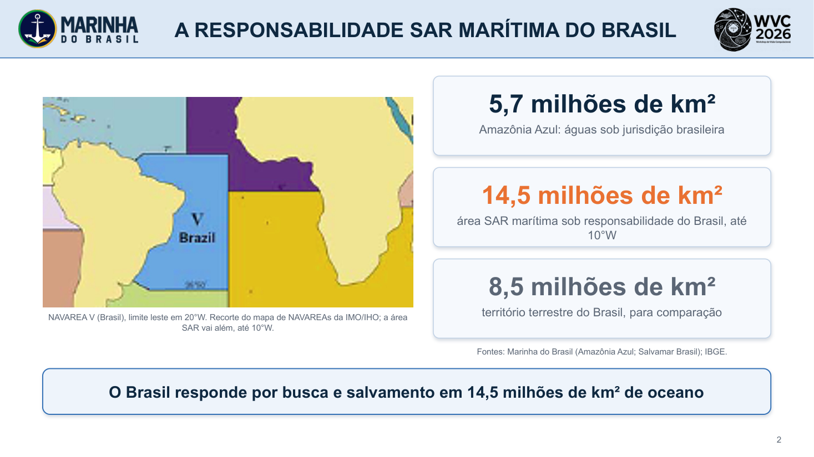

The maritime SAR region under Brazil's responsibility is about 14.5 million km²; Brazil's land area is 8.5 million km² (IBGE).

## Slide 3 · Searching at sea: ship vs. UAV

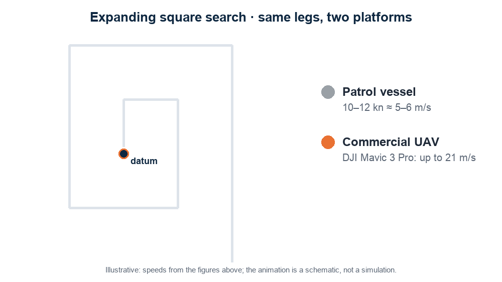

In an expanding square search from the last known position (datum), a commercial UAV (DJI Mavic 3 Pro, up to 21 m/s) flies the same legs 3–4× faster than a patrol vessel at 10–12 knots (≈ 5–6 m/s).

## Slide 4 · The problem: targets of a few pixels

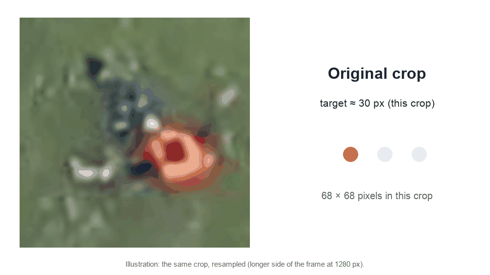

With the longer side at 1280 px, the median target is 16 px and the median life-saving appliance is 9.4 px.

## Slide 5 · Why YOLO26n, and what changes

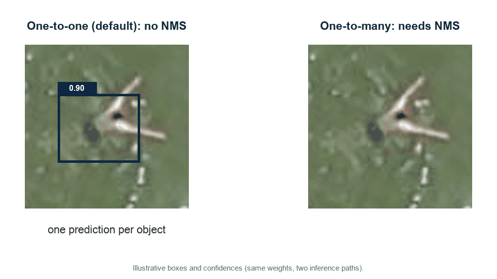

YOLO26n is fine-tuned from COCO-pretrained weights on the SeaDronesSee training set; its two heads share the same weights. The one-to-one head outputs one prediction per object and needs no NMS; the one-to-many head produces several candidates and needs NMS.

## Slide 6 · How we score: COCO AP

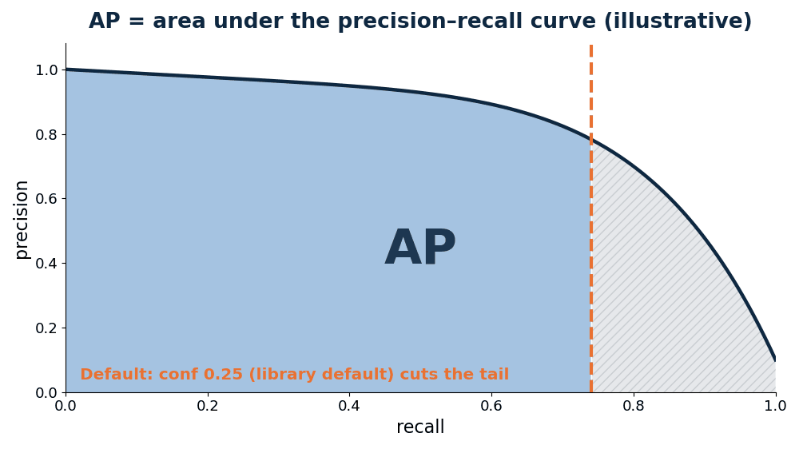

AP integrates the whole precision–recall curve. The Default prediction uses the library's 0.25 confidence threshold, which cuts the low-confidence tail; lowering it to 0.001 adds the tail without changing any detection above 0.25.

## Slide 7 · Resolution first

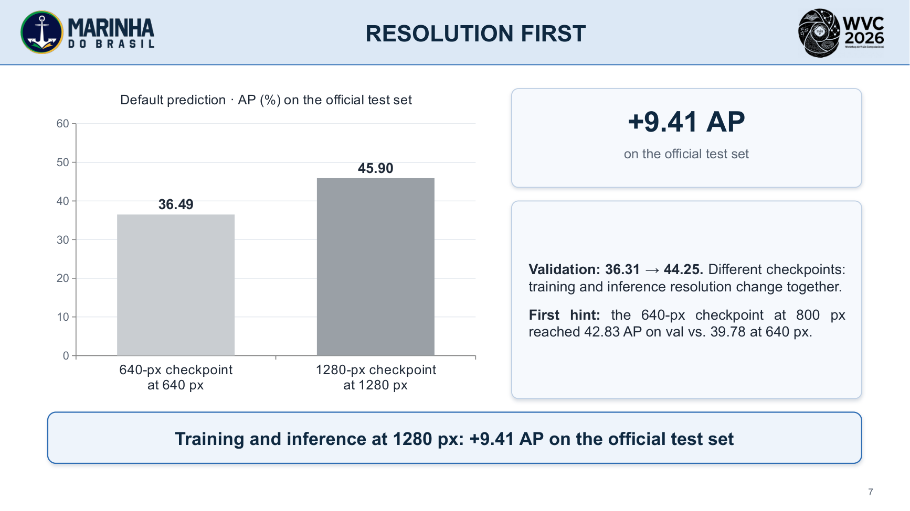

Default prediction on the official test set: 36.49 AP (640-px checkpoint) → 45.90 AP (1280-px checkpoint), +9.41 AP. These are different checkpoints, so training and inference resolution change together.

## Slide 8 · Hard-NMS vs. Soft-NMS

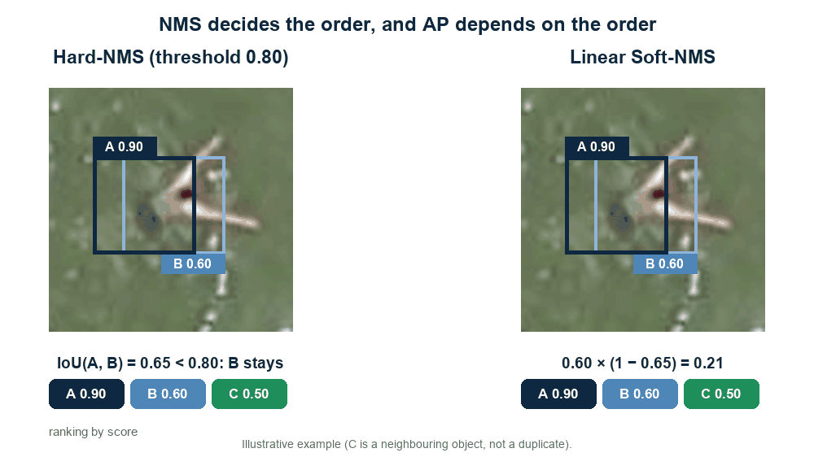

The confidence threshold decides how many boxes enter; NMS decides their order, and AP depends on the order. Hard-NMS (IoU threshold 0.80) keeps a duplicate with IoU 0.65 at full score; linear Soft-NMS lowers it (0.60 × (1 − 0.65) = 0.21) so a real neighbour ranks above it. Illustrative example.

## Slide 9 · SAHI, TTA and Flip + WBF

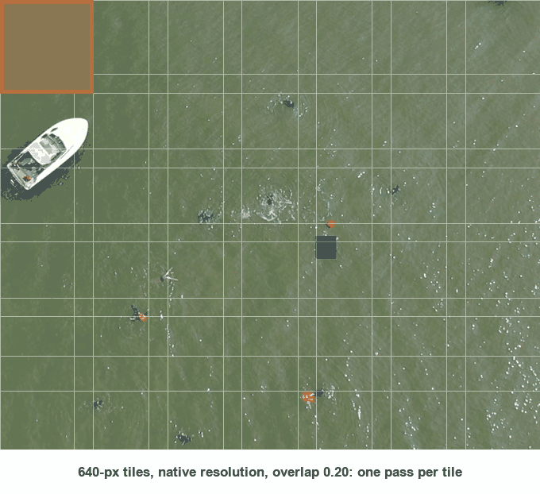

SAHI runs the detector on overlapping 640-px tiles at native resolution (about 39 forward passes per image in the paper; the grid here is illustrative). Flip + WBF fuses the image and its mirror (2 passes).

## Slide 10 · Cost vs. accuracy

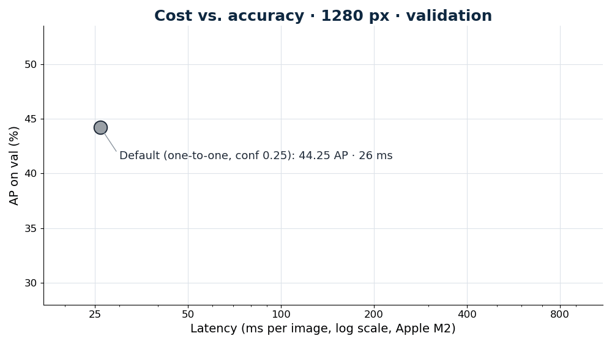

Single pass with linear Soft-NMS: 48.50 AP at 31 ms. Flip + WBF: 46.13 AP at 59 ms. SAHI: 31.17 to 37.38 AP at about 760 ms. More passes cost more and do not improve AP.

## Slide 11 · Why does SAHI lose? (hypotheses)

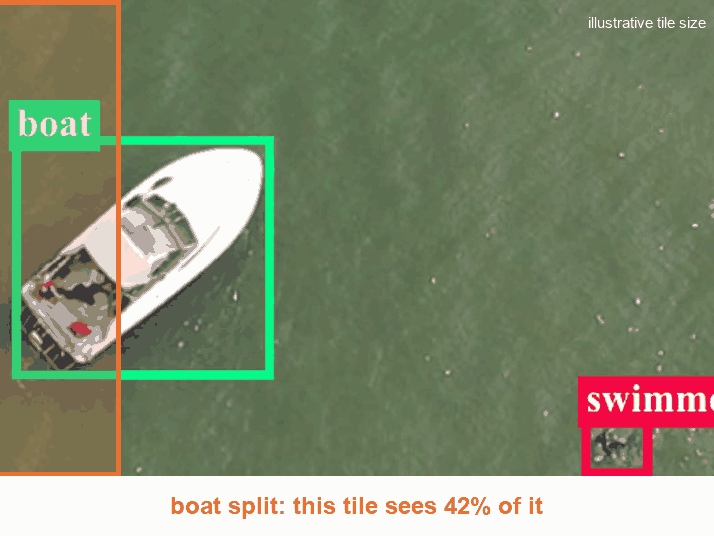

Two hypotheses, neither tested: large objects such as boats are split across tiles, and in native-resolution tiles objects appear about 3× larger than in training (5,800 of the 8,930 training images are 3840 × 2160). SAHI was used without slicing-aided fine-tuning. The tile size in the animation is illustrative.

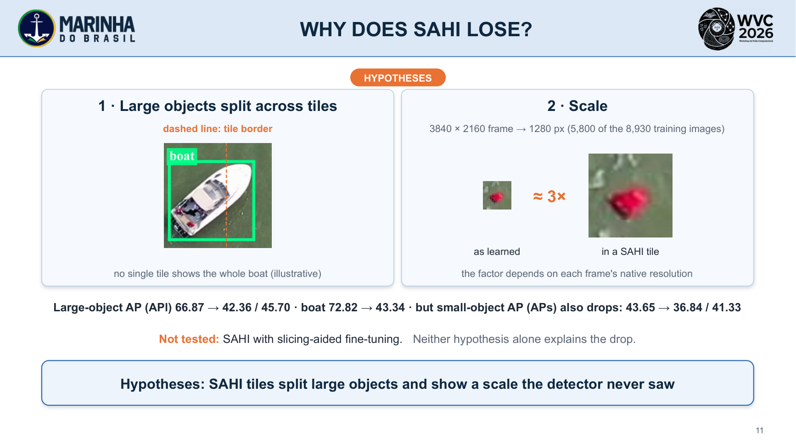

## Slide 12 · Head, Soft-NMS and the operating point

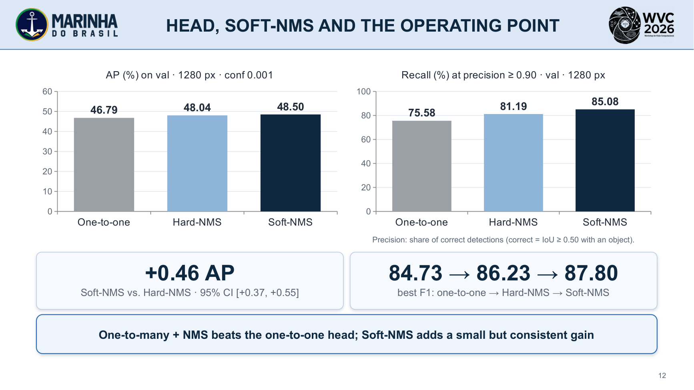

At the same confidence threshold, one-to-many + Hard-NMS beats the one-to-one head (48.04 vs. 46.79 AP); Soft-NMS adds +0.46 AP (95% CI [+0.37, +0.55]). At precision ≥ 0.90 (a detection is correct if its IoU with an object is ≥ 0.50), recall is 75.58 / 81.19 / 85.08%.

## Slide 13 · Official test: where the gain comes from

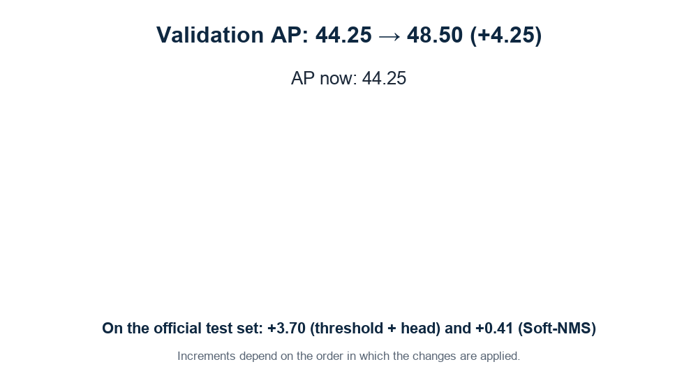

On validation, of the 4.25 points: 2.54 come only from lowering the confidence threshold from 0.25 to 0.001 (a protocol effect), 1.25 from the one-to-many head with Hard-NMS and 0.46 from Soft-NMS. On the official test set: +3.70 (threshold + head) and +0.41 (Soft-NMS).

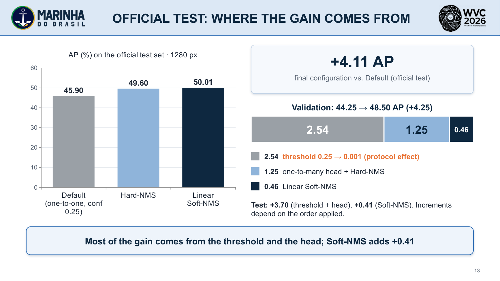

## Slide 14 · Conclusions and next steps

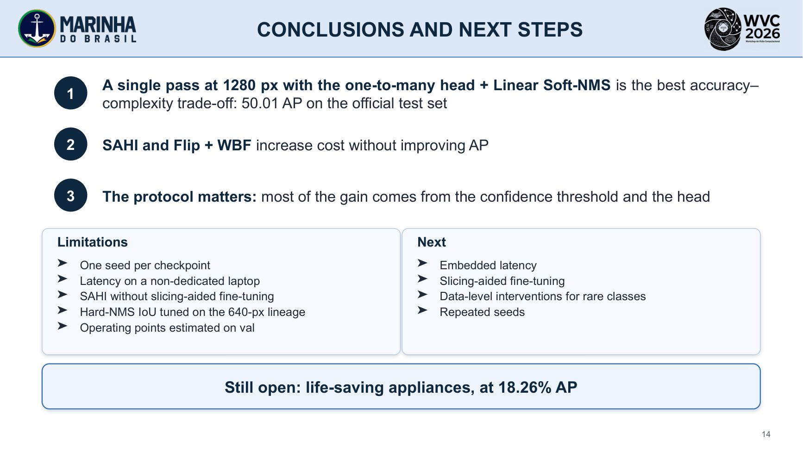
