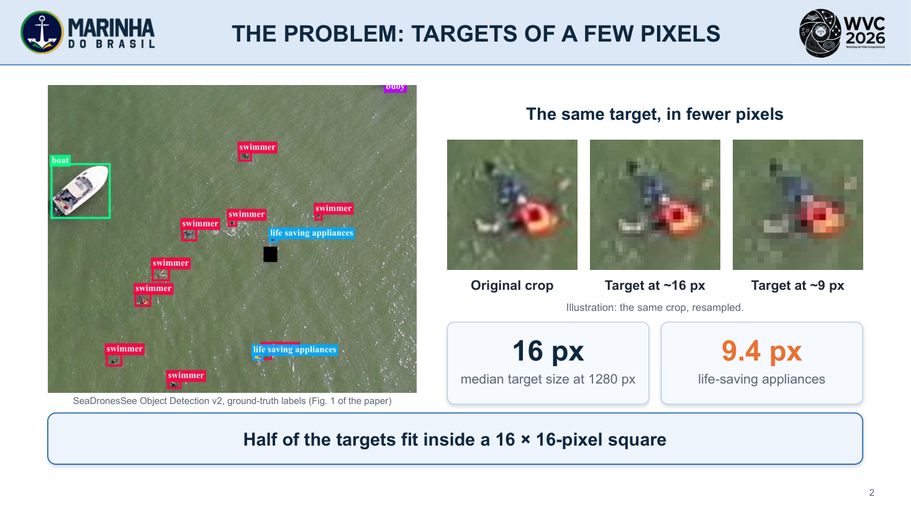
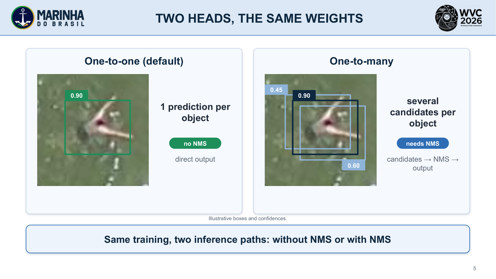
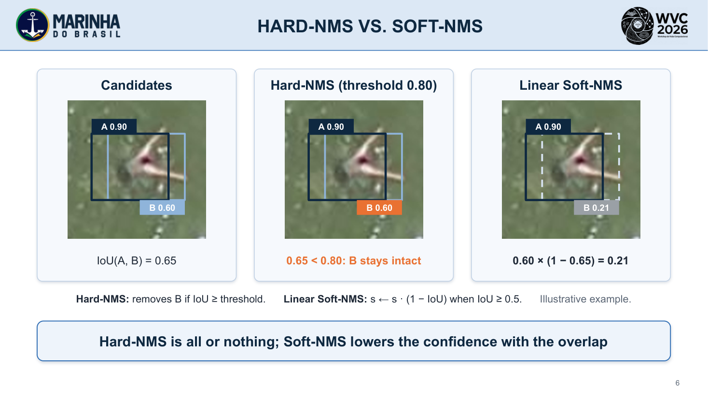
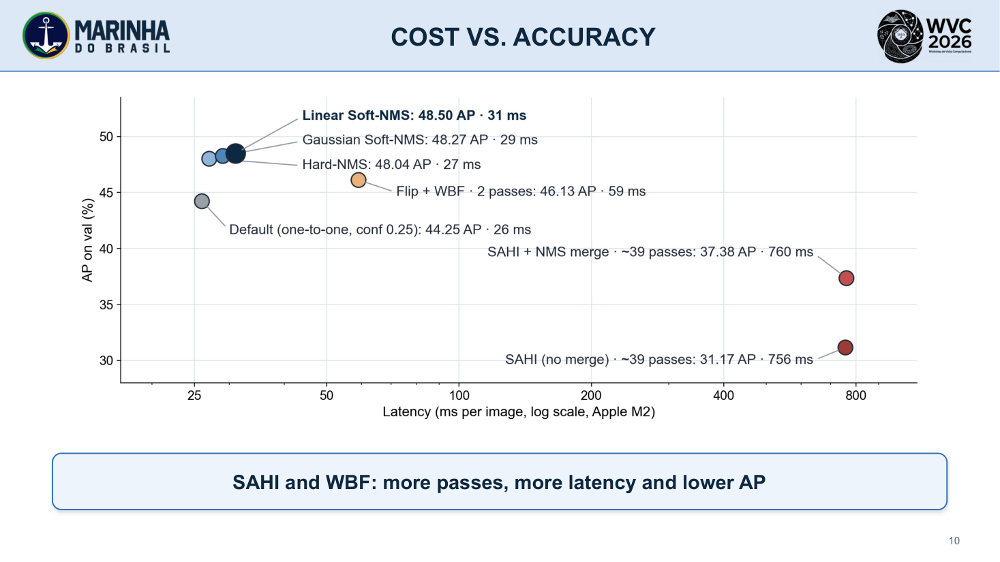
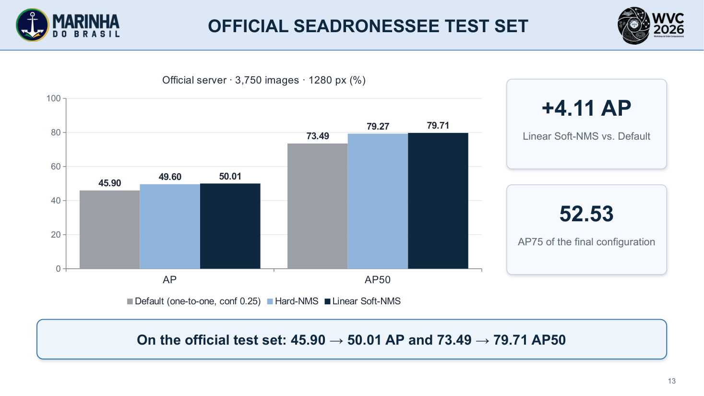
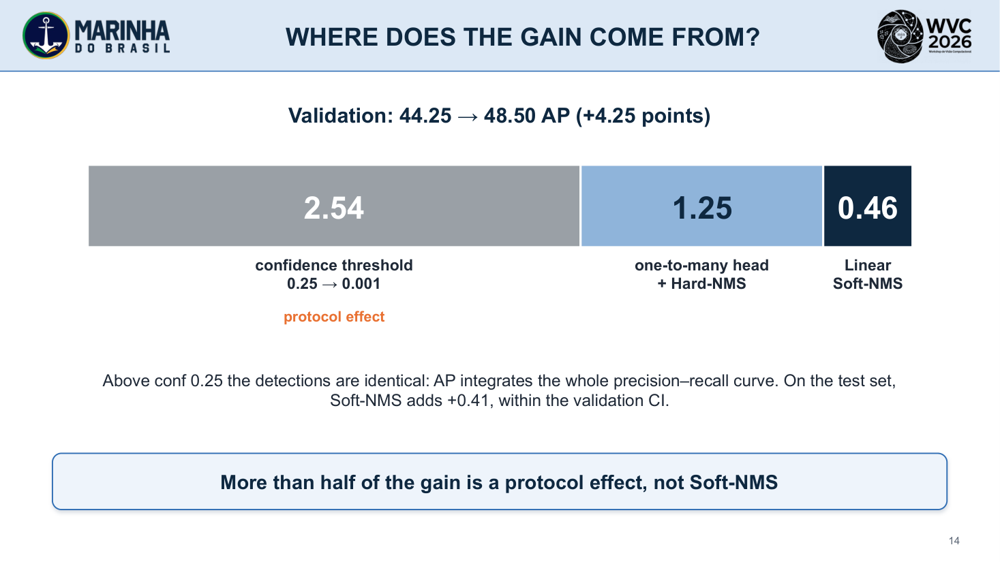

# Maritime Search and Rescue: An Evaluation of Small-Object Detection in UAV Imagery

**Ighor de Souza Ribeiro** (CIAA), **Rigel Procópio Fernandes** (DSAM)

WVC 2026 — XXI Workshop on Computer Vision

**[Slides (PDF)](slides/WVC2026_slides_en.pdf)** · [Slides (PPTX)](slides/WVC2026_slides_en.pptx) · [Code and parameters](https://github.com/IghorRibeiro/yolo26n-seadronessee-postprocessing)

Versão em português: [README.pt.md](README.pt.md) · [Slides (PDF)](slides/WVC2026_slides.pdf) · [Slides (PPTX)](slides/WVC2026_slides.pptx)

---

## Slide 2 · The problem: targets of a few pixels

With the longer side at 1280 px, the median target size is 16 px; for life-saving appliances, 9.4 px.

## Slide 5 · Two heads, the same weights

The one-to-one head outputs a single prediction per object and needs no NMS; the one-to-many head produces several candidates and needs NMS.

## Slide 6 · Hard-NMS vs. Soft-NMS

Hard-NMS is all or nothing at the IoU threshold; linear Soft-NMS lowers the confidence with the overlap (illustrative example).

## Slide 7 · SAHI and Flip + WBF

SAHI processes overlapping 640-px tiles at native resolution (about 39 forward passes per image; illustrative grid). Flip + WBF fuses the boxes of the image and its mirror (2 passes).

## Slide 10 · Cost vs. accuracy

Single pass with linear Soft-NMS: 48.50 AP at 31 ms. Flip + WBF: 46.13 AP at 59 ms. SAHI: 31.17 to 37.38 AP at about 760 ms.

## Slide 11 · Why does SAHI lose? (hypothesis)

Hypothesis, not tested: in native-resolution tiles the objects appear about 3× larger than in training, and no slicing-aided fine-tuning was applied.

## Slide 13 · Official SeaDronesSee test set

AP 45.90 → 50.01 and AP50 73.49 → 79.71 from Default (one-to-one head, confidence 0.25) to linear Soft-NMS; final AP75 of 52.53.

## Slide 14 · Where does the gain come from?

On validation, of the 4.25 points: 2.54 come only from the confidence threshold (a protocol effect), 1.25 from the one-to-many head with Hard-NMS and 0.46 from Soft-NMS.
