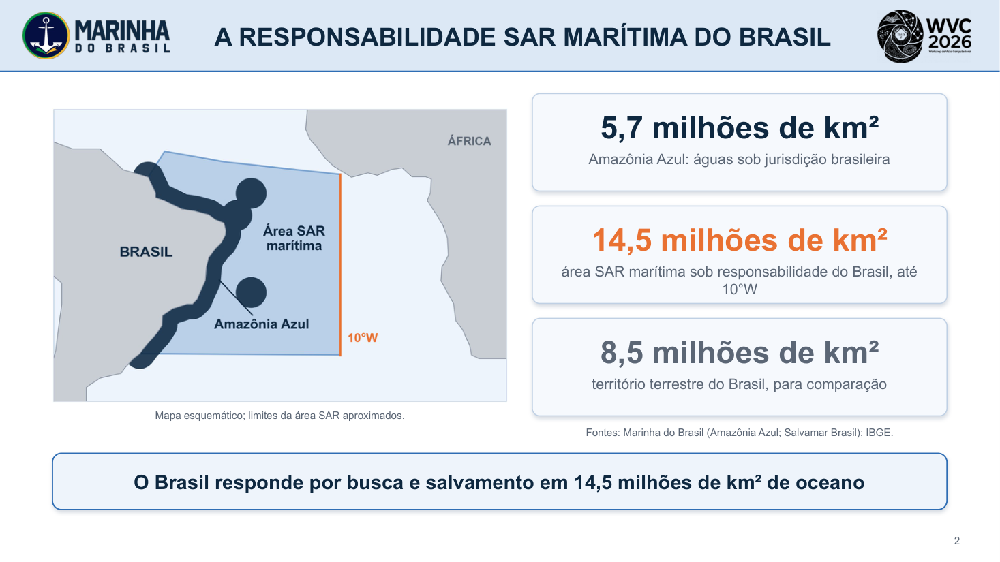
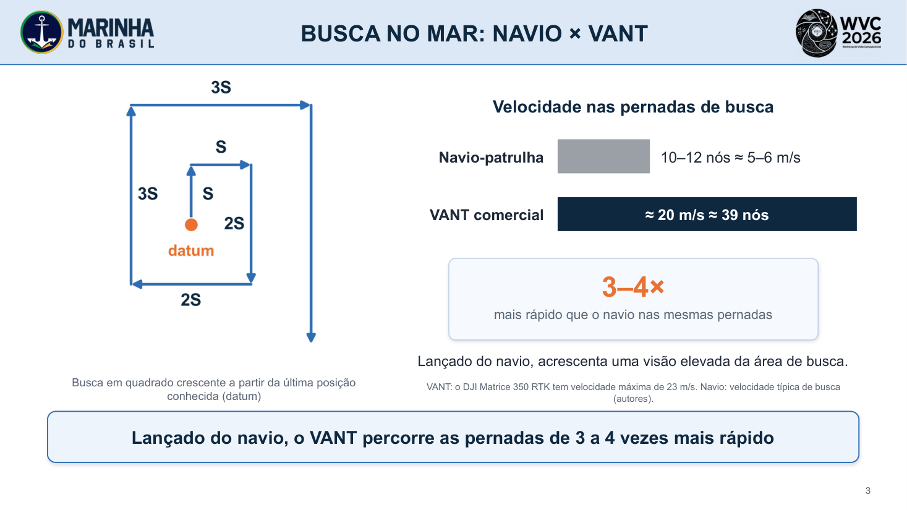
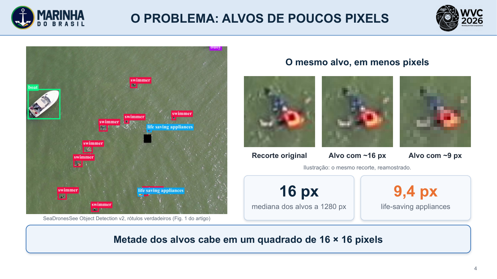
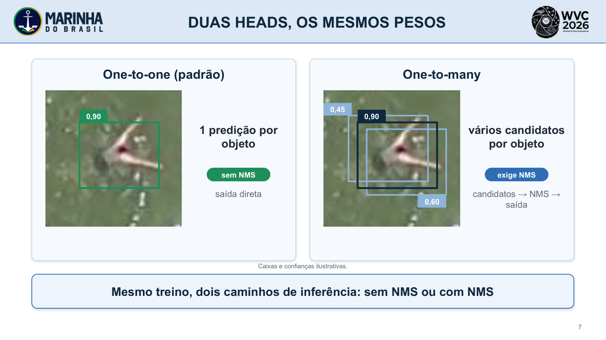
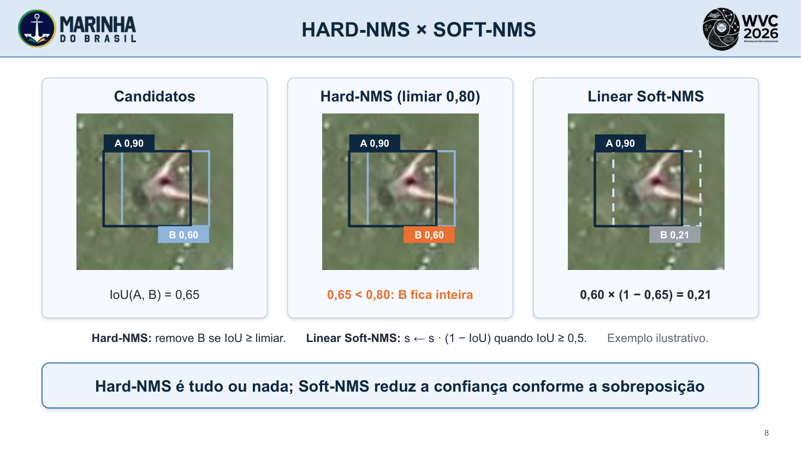
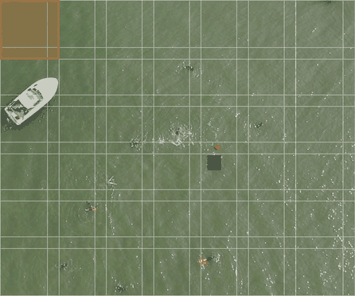
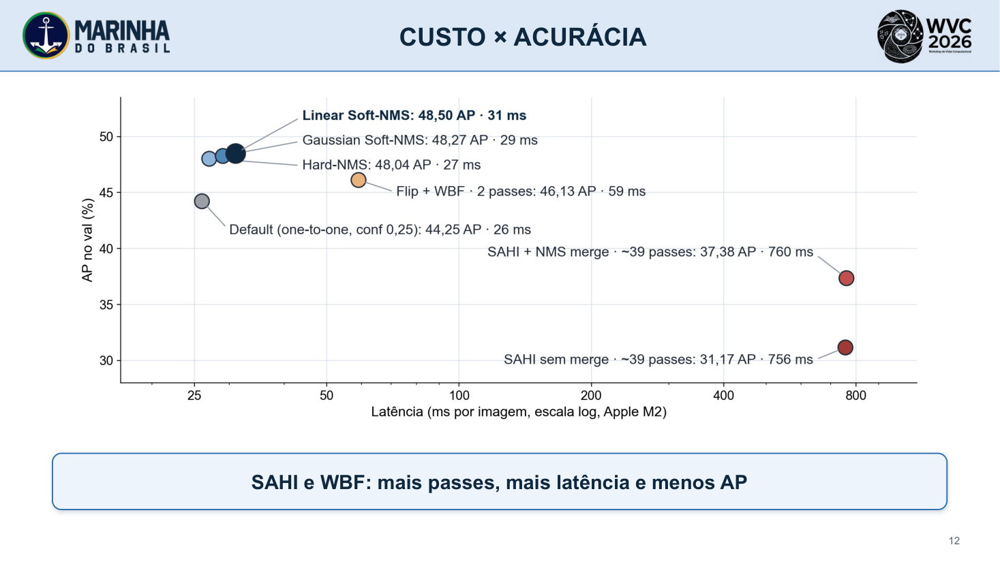
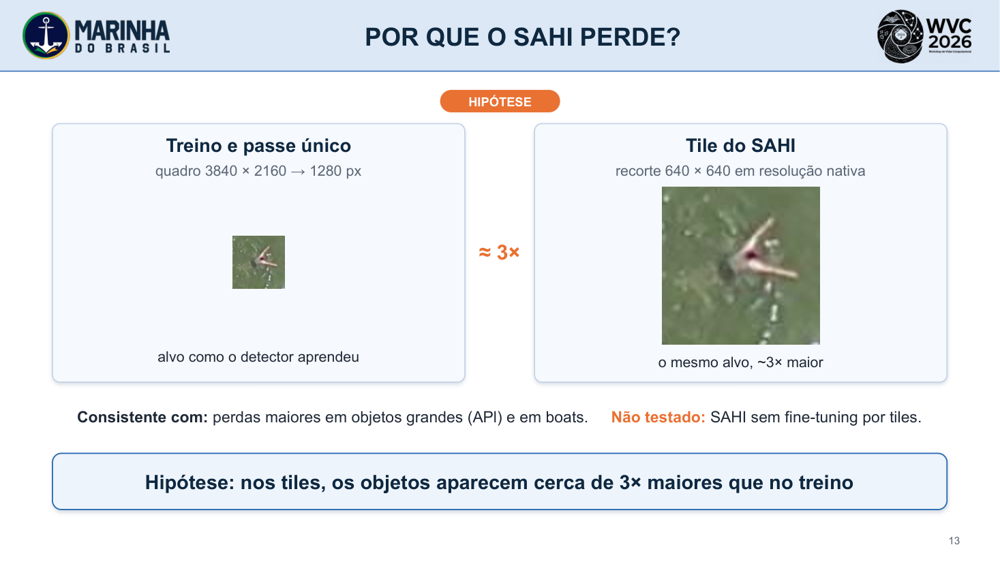
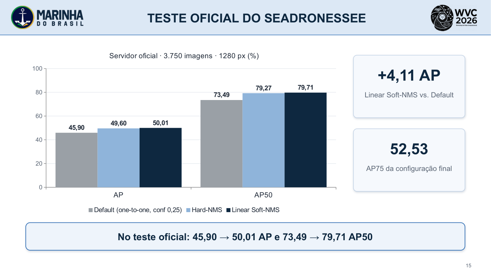
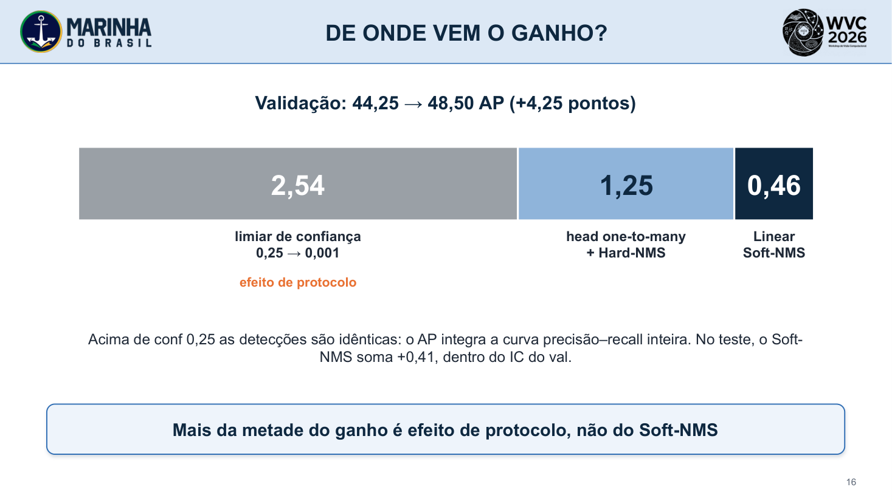

# Maritime Search and Rescue: An Evaluation of Small-Object Detection in UAV Imagery

**Ighor de Souza Ribeiro** (CIAA), **Rigel Procópio Fernandes** (DSAM)

WVC 2026 — XXI Workshop de Visão Computacional

[English version](README.md)

**[Slides (PDF)](slides/WVC2026_slides.pdf)** · [Slides (PPTX)](slides/WVC2026_slides.pptx) · [Código e parâmetros](https://github.com/IghorRibeiro/yolo26n-seadronessee-postprocessing)

---

## Slide 2 · A responsabilidade SAR marítima do Brasil

A Amazônia Azul tem cerca de 5,7 milhões de km²; a área SAR marítima sob responsabilidade do Brasil tem cerca de 14,5 milhões de km², até 10°W (mapa esquemático, limites aproximados).

## Slide 3 · Busca no mar: navio × VANT

Numa busca em quadrado crescente, um VANT comercial a cerca de 20 m/s percorre as mesmas pernadas de 3 a 4 vezes mais rápido que um navio-patrulha a 10–12 nós.

## Slide 4 · O problema: alvos de poucos pixels

Com o lado maior em 1280 px, a mediana do tamanho dos alvos é 16 px; nas life-saving appliances, 9,4 px.

## Slide 7 · Duas heads, os mesmos pesos

A head one-to-one emite uma predição por objeto e dispensa NMS; a one-to-many gera vários candidatos e exige NMS.

## Slide 8 · Hard-NMS × Soft-NMS

Hard-NMS é tudo ou nada no limiar de IoU; o Soft-NMS linear reduz a confiança conforme a sobreposição (exemplo ilustrativo).

## Slide 9 · SAHI e Flip + WBF

O SAHI processa tiles sobrepostos de 640 px em resolução nativa (cerca de 39 passes por imagem; grade ilustrativa). O Flip + WBF funde as caixas da imagem e do espelho (2 passes).

## Slide 12 · Custo × acurácia

Um passe com Linear Soft-NMS: 48,50 AP a 31 ms. Flip + WBF: 46,13 AP a 59 ms. SAHI: 31,17 a 37,38 AP a cerca de 760 ms.

## Slide 13 · Por que o SAHI perde? (hipótese)

Hipótese, não testada: nos tiles em resolução nativa os objetos aparecem cerca de 3× maiores que no treino, e não houve fine-tuning por tiles.

## Slide 15 · Teste oficial do SeaDronesSee

AP 45,90 → 50,01 e AP50 73,49 → 79,71 do Default (one-to-one, conf 0,25) para o Linear Soft-NMS; AP75 final de 52,53.

## Slide 16 · De onde vem o ganho?

No val, dos 4,25 pontos: 2,54 vêm só do limiar de confiança (efeito de protocolo), 1,25 da head one-to-many com Hard-NMS e 0,46 do Soft-NMS.
